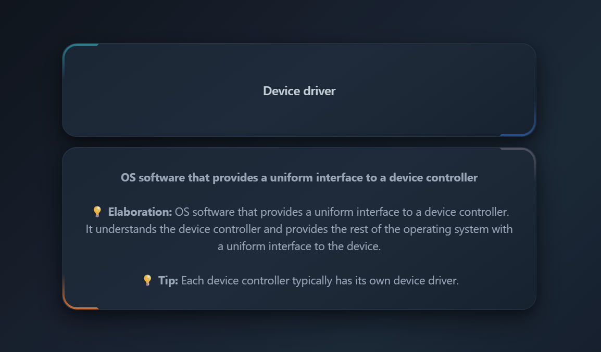
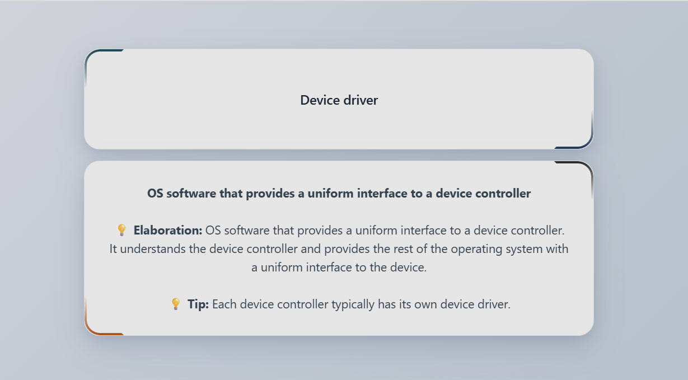

## ankiCardStyles For Everyankier

Meet these card styles - delightful as they are, why not integrate them into your Anki reviews?

### Contributing ♥

Thanks for contributing! Feel free to open an Issue to suggest a card style or a PR if you have one you're excited to share!

> By the Anki community, for the Anki community. Here we proudly say: FOSS Forever!!

### 🎉 Show Your Support

If you find the cards absolutely stunning, feel free to:
- ⭐ Star the repository
- 🍴 Fork it to explore
- 👀 Watch for updates
- 📢 Sharing is caring! Let's share ankiCardStyles!

---

### Styles for Wonderful Times 
Pick one (or three) of your favourites and - why wait - try them out on your cards! And if anyone asks about you and your cool cards, don't be shy and point them to the nice ankiCardStyles repo. ;)

#### 1. Dark Pastel
- **🌟 Creator's Favourite 🌟**
- File: `dark-pastel.css`
- Date Added: 13/11/2026

#### 2. Light Pastel
- File: `light-pastel.css`
- Date Added: 13/11/2026

